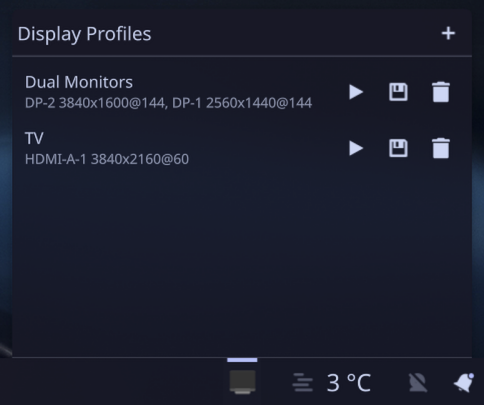

# Display Config Switcher

A Plasma 6 plasmoid that lets you save and switch between display configurations.

> [!NOTE]
> This project was primarily developed with ~~[Claude Code](https://claude.ai/code)~~ [OpenCode](https://opencode.ai/) and [OpenChamber](https://openchamber.dev/) using OpenAI models.  
> I quickly created this for myself as there seems to be no maintained alternative.  
> I can't really guarantee best practices are followed, but it works fine for me.  
> If you're using it and it works, great! If not or something is missing, feel free to create an issue and I'll see what I can do.



## Features

- Save your current display configuration as a named profile
- Switch between saved profiles from the panel
- Uses `kscreen-doctor` under the hood for display management
- Supports Wayland; older Plasma releases also provide X11 sessions (Plasma 6.8 removed them)

## Installation

Requires Plasma 6, `kscreen-doctor` (from libkscreen), the Plasma and Kirigami
QML modules, and the Plasma5Support QML module with its executable engine.
Distribution package names vary; Plasma5Support is still needed on Plasma 6.

```bash
kpackagetool6 -t Plasma/Applet --install package/
```

After installation, add "Display Config Switcher" to your panel via the widget picker.

To upgrade after pulling new changes:

```bash
kpackagetool6 -t Plasma/Applet --upgrade package/
```

Restart the Plasma Shell afterwards, e.g. via `systemctl --user restart plasma-plasmashell.service`

To remove:

```bash
kpackagetool6 -t Plasma/Applet --remove dev.markusrenken.displayconfigswitcher
```

## Using profiles

Save your current display configuration with **+**, then apply, overwrite or
delete it from the profile list.
The **+** button opens an inline name field. Updating or deleting asks for
confirmation within the profile's row. An existing name offers **Update existing**
instead of **Save**. Use **Cancel** or Escape to dismiss an edit.

### Shared profiles

Profiles are shared between widget instances and stored in
`${XDG_CONFIG_HOME:-$HOME/.config}/displayconfigswitcher-profiles.json`.
Reopen a widget's popup to see changes made in another instance. Simultaneous
edits from different instances can overwrite each other.

If reading or saving fails, the widget shows an error and keeps the displayed
profiles intact. Use **Retry** after resolving the problem.

### Applying profiles

Saved active displays must be connected, and their modes and settings must be
available. The widget checks these before applying and reports any problems.
Displays not in the profile are left as they are.

Profiles restore enabled state, resolution and refresh rate, position, scale,
rotation/reflection, display priority, VRR, HDR, wide color gamut, SDR brightness,
brightness and overscan where supported. ICC profiles and mirroring are not
restored. Profiles saved on different hardware or newer software may need to be
saved again for the current setup.

The widget checks the result and reports settings that were not restored.
An apply error can mean some settings changed; inspect the display configuration
before trying again. Changes are not automatically rolled back.

## Development

### Requirements

- Plasma 6 development environment
- `kpackagetool6` (from KPackage; distribution package names vary)
- `plasmoidviewer` (from `plasma-sdk`, optional, for testing without installing)
- CMake, ECM and libplasma development packages (optional, for system-wide install)

### Testing

Run the JavaScript and shell-storage tests with Node.js 18 or newer:

```bash
node --test tests/*.test.mjs
```

Run the QML integration tests with Qt 6 QtTest and the runtime dependencies above:

```bash
sh tests/run-qml-tests.sh
# Optional: pass your Qt 6 qmltestrunner path as the first argument.
```

The QML harness uses an isolated config directory and a fake `kscreen-doctor`;
it does not change your display configuration.

For a manual Plasma check:

```bash
plasmoidviewer -a package/
```

Exercise save, apply, overwrite, delete and Retry, including multiple widget
instances. Applying a profile changes the running desktop's displays.

## Releasing

1. Include a `Version` bump in [package/metadata.json](package/metadata.json) in your PR
2. Merge the PR to main
3. Tag the merge commit and push the tag:
   ```bash
   git pull origin main
   git tag v<version>
   git push origin v<version>
   ```
4. GitHub Actions builds the `.plasmoid` file and creates a [GitHub Release](https://github.com/z0n/plasma-applet-display-config-switcher/releases)
5. Upload the `.plasmoid` from the release to the [KDE Store](https://store.kde.org)
